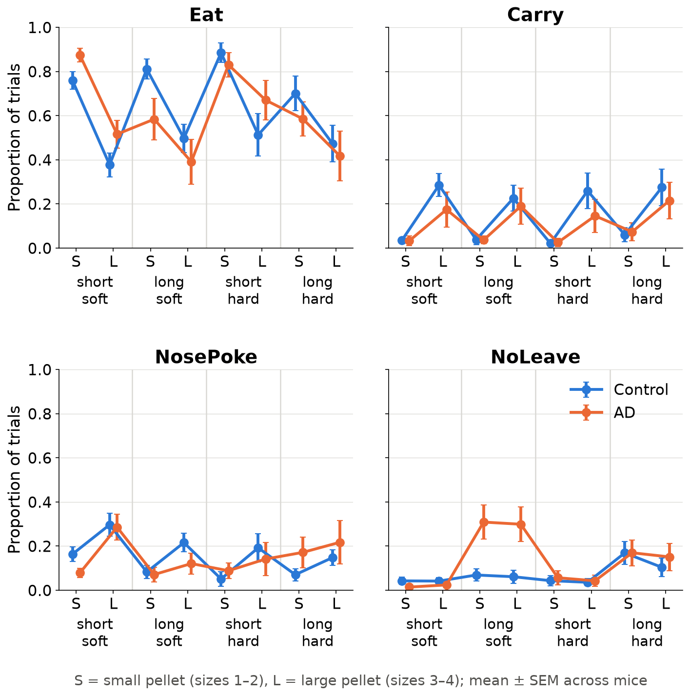
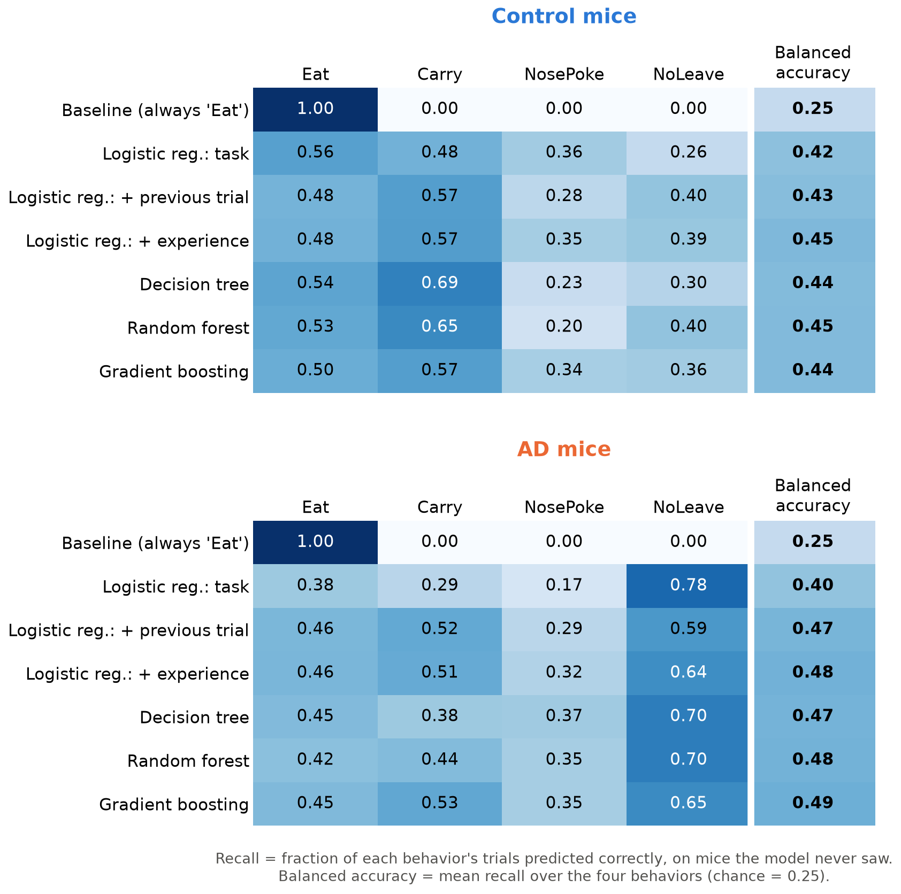
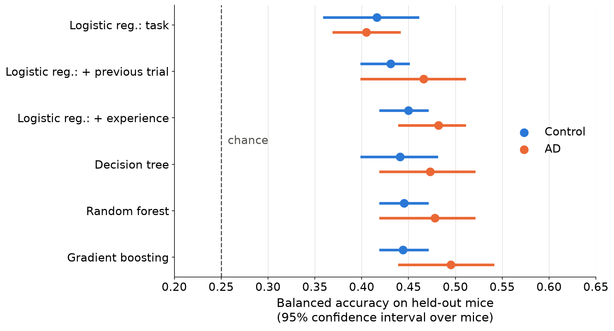
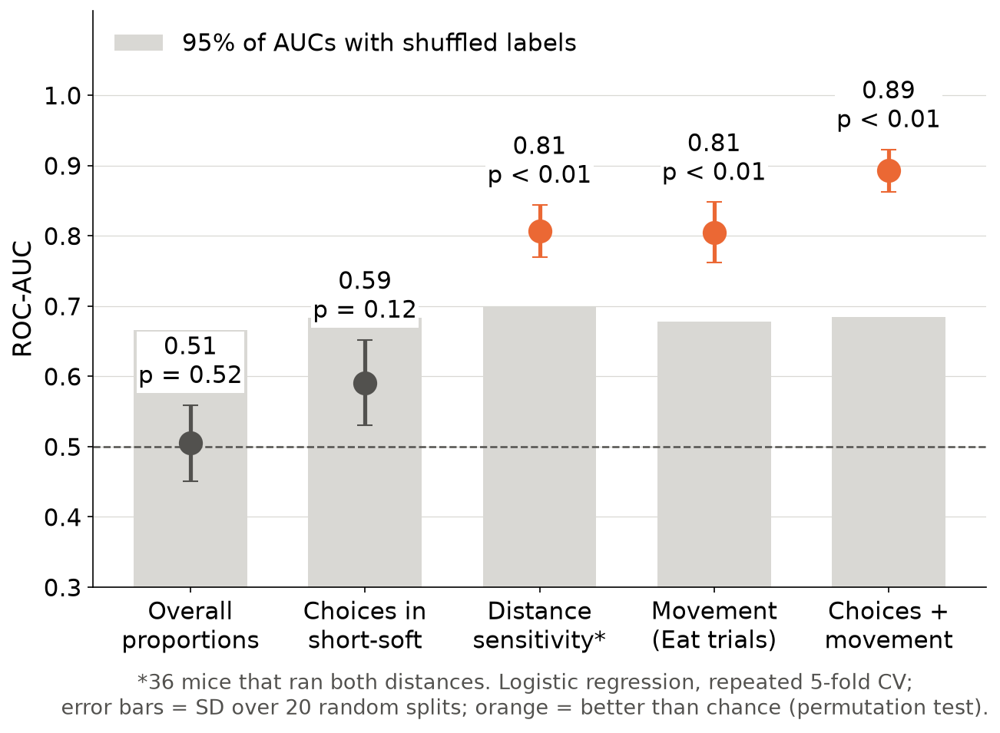
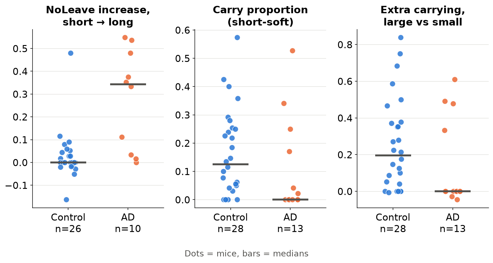

<p align="center">
  
</p>

# Foraging Decision Classification in Control and Alzheimer's Disease Model Mice

Interpretable machine learning on a mouse foraging task: **predicting which foraging decision a mouse makes**, and **classifying healthy vs Alzheimer's-disease-model mice from their behavior**, with validation designed around the fact that the independent unit is the *animal*, not the trial.

> **Status:** analysis complete (4 notebooks). The data are unpublished; results are exploratory and predictive, not causal.

---

## Contents
- [Scientific motivation](#scientific-motivation)
- [The experiment and the data](#the-experiment-and-the-data)
- [Research questions](#research-questions)
- [Methods](#methods)
- [Main results](#main-results)
- [Limitations](#limitations)
- [Repository structure](#repository-structure)
- [Installation and reproduction](#installation-and-reproduction)
- [References](#references)
- [License](#license)

---

## Scientific motivation

Foraging requires weighing costs (distance, effort, exposure) against benefits (food size and quality), and adapting the choice when conditions change. These computations depend on brain circuits that are affected early in Alzheimer's disease. A foraging task can therefore reveal changes in **cost–benefit decision-making** and **behavioral flexibility** that simple activity measures miss.

This project asks how much of a mouse's foraging choice can be predicted from the task situation and its recent history, and whether the *pattern* of choices distinguishes Alzheimer's-model mice from healthy controls.

## The experiment and the data

| | |
|---|---|
| **Animals** | 28 Control mice (C57BL/6J) and 13 AD-model mice (*App*<sup>NL-G-F</sup> knock-in) |
| **Trials** | 5,377 usable trials in 1,409 sessions (26–239 trials per mouse) |
| **Task parameters** | travel distance (short 50 cm / long 100 cm) × food texture (soft / hard) × pellet size (1–4, pooled into *small* = 1–2 and *large* = 3–4) |
| **Session** | 4 trials, one per pellet size, in randomized order; conditions were presented in blocks of sessions |
| **Outcome per trial** | **Eat** (eat at the food site; includes partial eating), **Carry** (carry the pellet home), **NosePoke** (inspect without taking), **NoLeave** (stay home for the 3-min trial) |
| **Movement measures** | start latency, outbound/inbound speeds (cm/s), time at the food site, number of back-and-forth trips |

**Data availability:** the raw trial table (one row per trial) is not included in this repository because the data are unpublished. It is available on request; please open an issue. Cleaning decisions (reconstructing sessions from dates, removing invalid trials, handling structurally missing values, etc.) are documented step by step in [notebook 01](notebooks/01_data_exploration.ipynb).



*Per-mouse behavior proportions (mean ± SEM across mice). Large pellets shift behavior from eating on the spot toward carrying in both groups; AD mice stay home far more often when the distance first becomes long (long-soft).*

## Research questions

1. **Behavior classification:** Can a mouse's choice on a trial be predicted from information available *before* the trial? Does this generalize to unseen mice, and do Control and AD mice follow different rules?
2. **Group classification:** Can a mouse's behavioral profile identify whether it is a Control or an AD-model mouse, and which behaviors separate the groups?

## Methods

### Key design principles
| Principle | Implementation |
|---|---|
| **The mouse is the independent unit** | All validation holds out entire mice. For group classification, each mouse is summarized into one row of features (n = 41), never classified trial by trial. |
| **No target leakage** | Prospective models use only information available before the decision: task parameters, previous trial outcome, experience. Movement measured during or after the behavior (time at food, return speed, back-and-forth) is never used as a predictor. Approach measures (start latency, initial speed) are used only for the later food-site decision, on trials where the mouse left home. |
| **Leakage-safe pipelines** | Encoding, imputation and scaling are fitted inside scikit-learn `Pipeline`s on training mice only; class imbalance is handled with class weights (no synthetic resampling). |
| **Honest model selection** | Nested cross-validation: hyperparameters are tuned on training mice only. |
| **Uncertainty first** | Bootstrap confidence intervals over **mice**, repeated cross-validation, and label-permutation tests. |
| **Structural missingness** | Movement values do not exist for NoLeave trials; they are kept missing (not set to 0) and excluded where meaningless. |

### Models
- **Multinomial logistic regression** (L2-regularized): main model, chosen for interpretability and robustness
- **Decision tree, random forest, gradient boosting**: flexible comparisons
- **Baselines:** class-frequency predictor

### Validation
| Analysis | Scheme | Metrics |
|---|---|---|
| Behavior classification | leave-one-mouse-out (outer) + grouped 5-fold (inner tuning) | balanced accuracy, macro-F1, multiclass log loss, per-class metrics, calibration |
| Group classification | repeated stratified 5-fold over mice (20×), nested tuning | ROC-AUC, balanced accuracy, permutation test (500 label shuffles) |
| Interpretation | grouped 5-fold | permutation importance on held-out mice; model-predicted probabilities with mouse-bootstrap ranges |

## Main results

### 1. Behavior is partly predictable before the trial, mainly from pellet size and the previous outcome



*Each cell shows the recall of one behavior (fraction of its trials predicted correctly) on mice the model never saw. The baseline always answers "Eat" (recall 1 for Eat, 0 otherwise). The trained models trade some Eat recall for recognizing the rarer behaviors.*



- On unseen mice, logistic regression reaches a **balanced accuracy of 0.45 (Control) and 0.48 (AD)**; chance = 0.25. Task parameters alone give ~0.41.
- **Flexible models do not help:** random forest and gradient boosting are within ±0.02 of logistic regression.
- **The previous trial's outcome matters more for AD mice** (macro-F1 +0.07, 95% CI +0.03 to +0.12; Control: −0.01, CI includes 0). Behaviors persist from trial to trial in both groups.
- **NoLeave is much more predictable in AD mice** (F1 0.41 vs 0.24); Carry is less predictable (0.29 vs 0.40).
- At the food site (Eat vs Carry vs NosePoke), adding the approach behavior (start latency, initial speed) adds little or nothing (Control −0.01; AD +0.03, uncertain).
- **Individual mice differ a lot:** balanced accuracy per held-out mouse ranges from 0.15 to 0.67.

> **Why can a *randomized* variable predict behavior?** The *order* of pellet sizes was randomized, but the mouse's response to the pellet is not random. Randomization guarantees that pellet size is not mixed up with anything else (trial position, previous outcome, experience). The size effect is therefore the one effect in this study backed by experimental randomization, and the cleanest causal result. The data also show *when* size acts:
> - **Leaving home:** NoLeave is the same for small and large pellets (Control 6.4% vs 5.2%, AD 11.0% vs 10.2%), so size does not affect this decision (the mouse may not yet know the size).
> - **At the food:** among trials where the mouse left home, large pellets reduce eating on the spot from ~83–85% to ~46–54%, in favor of carrying and nose-poking.
>
> So size is predictive only for the decision taken *after* the pellet is encountered.

### 2. Genotype is invisible in overall behavior, but visible in *how* behavior changes with the task



| Mouse-level features | ROC-AUC | Permutation test |
|---|---|---|
| Overall behavior proportions | 0.51 | p = 0.52 |
| Choices in short-soft (proportions, size effect, switch rate) | 0.59 (random forest 0.74) | p = 0.12 |
| **Distance sensitivity** (change from short to long distance; 36 mice) | **0.81** | p < 0.01 |
| Movement on Eat trials | 0.81 | p < 0.01 |
| Choices + movement | 0.89 | p < 0.01 |



The features that separate the groups describe an **AD-associated profile**:
- many AD mice **stop leaving home when the distance increases** (6 of 10; only 1 of 26 Control mice);
- AD mice **eat on the spot more and rarely carry**, and do **not switch to carrying for large pellets**;
- AD mice switch less between behaviors and make fewer back-and-forth trips.

These patterns are consistent with **altered sensitivity to travel cost, weaker sensitivity to reward size, and less variable behavior**. These are hypotheses for future experiments, not demonstrated mechanisms.

### 3. Mostly shared decision rules, with heterogeneity among AD mice
- **Most important predictors** on held-out mice: pellet size for Control mice; previous outcome and distance for AD mice.
- **Shared vs group-specific models:** a single model shared by both groups predicts new mice **as well as** group-specific models. The AD-specific patterns are carried by a **subset of AD animals**, so they describe differences *between animals* more than a different rule for every AD mouse.

### 4. Methodological lessons demonstrated in the notebooks
- **Trial-level splitting inflates performance:** classifying genotype from single trials gave AUC 0.80 with trial-level CV but 0.67 when test mice were truly new.
- **Chance is wide with 41 samples:** with shuffled labels, AUCs up to ~0.70 occur; permutation tests are essential.
- **Class weights vs calibration:** class weights improve balanced accuracy but distort probabilities (worse log loss than the baseline); an unweighted model gives well-calibrated probabilities.
- **A silent pitfall:** `sklearn.metrics.log_loss` assumes probability columns in *alphabetical* class order; passing them in another order gives a wrong value without any error.

## Limitations

- **Predictive, not causal.** Results describe associations learned by models, not mechanisms. The exception is pellet size, whose order was randomized within each session; its effect on the choice at the food site is supported by the design.
- **Design confound:** conditions were presented in blocks (long-hard usually last), so condition effects are mixed with experience and with reactions to a *change* of condition.
- **Small AD group:** 13 AD mice (10 for distance features); estimates have wide uncertainty, and several AD effects are bimodal across animals.
- **Unbalanced coverage:** 13 mice never received hard food; group features were therefore computed in conditions all mice shared.
- **Testing period of control mice:** the Control group combines mice tested in 2020–21 and 2022, which moved very differently. Movement-based group separation is partly attributable to this (in an additional check, the movement-based AUC dropped from ~0.80 to ~0.71 without the 2022 controls); choice-based results were barely affected.
- **Completed behavioral records:** group classification uses each mouse's full record; it is not an early-detection test.

## Repository structure

```
├── data/
│   ├── raw/                             # raw trial table (not included; available on request)
│   └── processed/                       # created by notebook 01 (git-ignored)
├── notebooks/
│   ├── 01_data_exploration.ipynb        # data audit, cleaning, EDA
│   ├── 02_behavior_classification.ipynb # prospective behavior prediction
│   ├── 03_group_classification.ipynb    # Control vs AD from mouse-level features
│   └── 04_model_interpretation.ipynb    # importance, effects, shared vs group rules
├── src/
│   ├── data_processing.py               # cleaning steps (one function per step)
│   ├── feature_engineering.py           # mouse-level features
│   ├── modeling.py                      # leakage-safe model pipelines
│   ├── evaluation.py                    # leave-one-mouse-out, bootstrap, permutation tests
│   └── visualization.py                 # shared colors and plot style
├── scripts/make_readme_figures.py       # figures used in this README
├── results/
│   ├── figures/                         # all figures (notebook figures + readme/)
│   └── tables/                          # result tables (CSV)
├── tests/                               # pytest unit tests
├── Banner.png                           # README banner
├── LICENSE
└── requirements.txt
```

Each notebook explains every step for readers new to the methods: the goal, why it is needed, the concepts, the code, how to read the output, and its limitations.

## Installation and reproduction

```bash
git clone https://github.com/<your-username>/foraging-ml.git
cd foraging-ml

# Python 3.11, e.g. with conda
conda create -n foraging-ml python=3.11
conda activate foraging-ml
pip install -r requirements.txt
```

To re-run the analysis, place the raw data file (available on request) at `data/raw/foraging_trials.csv`. Without it, the notebooks can still be read with all their outputs, figures and explanations.

Run the notebooks **in order** (notebook 01 creates the cleaned data used by the others):

```bash
cd notebooks
jupyter nbconvert --to notebook --execute --inplace 01_data_exploration.ipynb
jupyter nbconvert --to notebook --execute --inplace 02_behavior_classification.ipynb   # 10-15 min
jupyter nbconvert --to notebook --execute --inplace 03_group_classification.ipynb      # 15-30 min (permutation tests)
jupyter nbconvert --to notebook --execute --inplace 04_model_interpretation.ipynb
cd ..
python scripts/make_readme_figures.py
python -m pytest tests
```

All random processes use fixed seeds, so results are reproducible.

## References

- Saito, T. et al. (2014). Single *App* knock-in mouse models of Alzheimer's disease. *Nature Neuroscience*, 17, 661–663. (the *App*<sup>NL-G-F</sup> mouse model)
- Pedregosa, F. et al. (2011). Scikit-learn: Machine learning in Python. *Journal of Machine Learning Research*, 12, 2825–2830.

The behavioral data in this repository have not yet been published.

## License

**All rights reserved.** The code, data, figures and documentation in this repository may be viewed for evaluation purposes only. Using, copying, modifying or redistributing any part of it, including the data, requires prior written permission from the author. To request permission, please open an issue in this repository. See [LICENSE](LICENSE).
